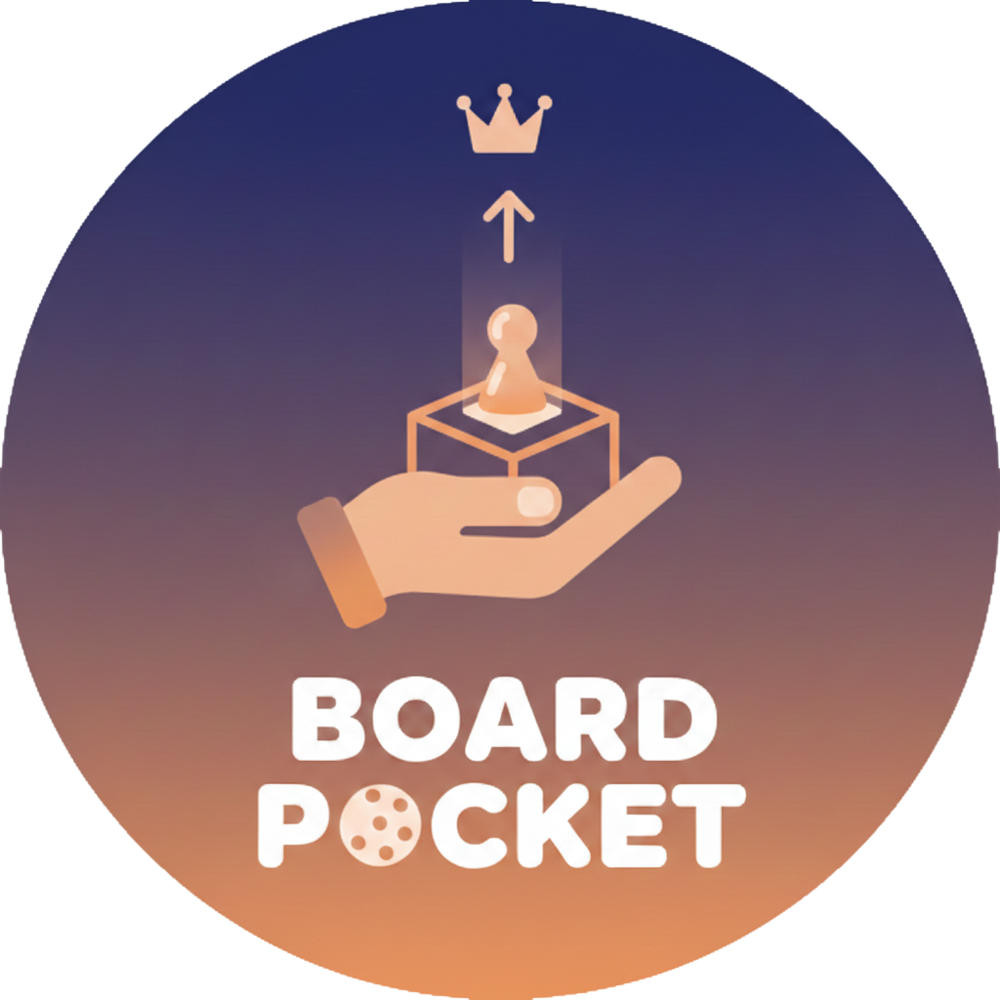
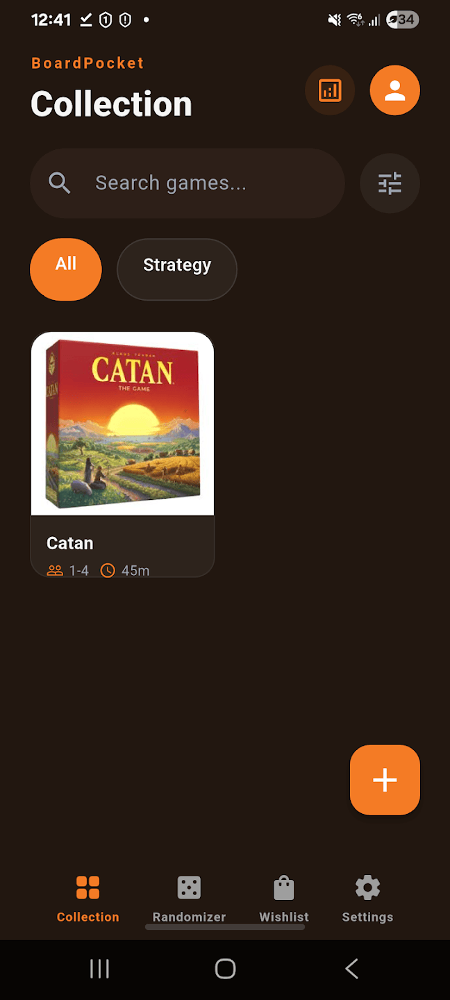
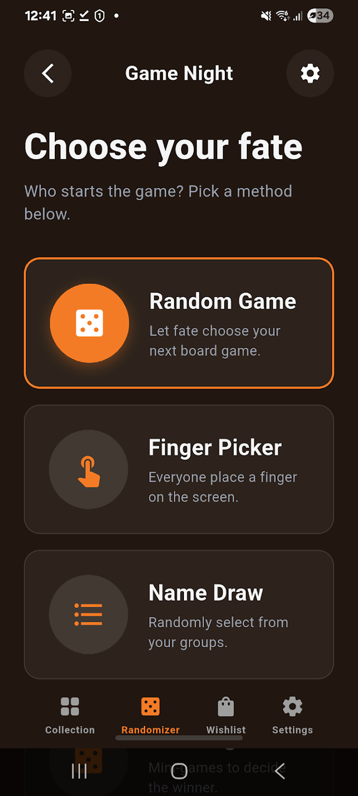
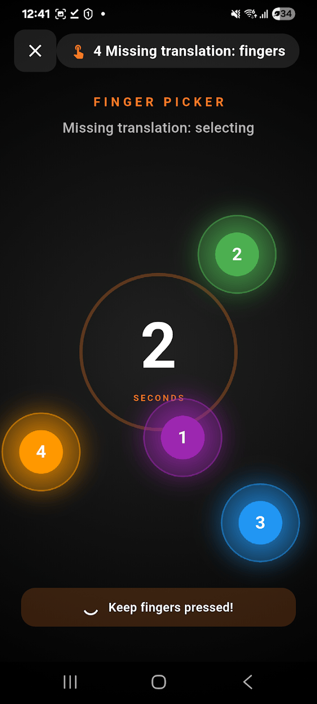
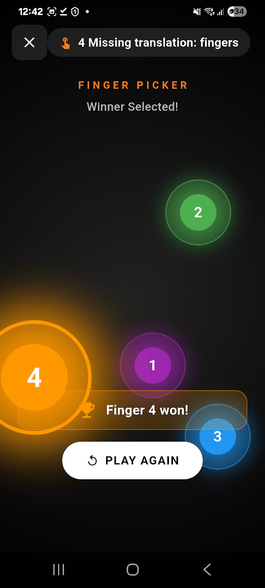

# BoardPocket

<p align="center">
  
</p>

<p align="center">
  <strong>Your digital companion for board game nights</strong>
</p>

<p align="center">
  <a href="#-features">Features</a> •
  <a href="#-screenshots">Screenshots</a> •
  <a href="#-installation">Installation</a> •
  <a href="#-getting-started">Getting Started</a> •
  <a href="#-tech-stack">Tech Stack</a> •
  <a href="#-contributing">Contributing</a> •
  <a href="#-license">License</a>
</p>

<p align="center">
  
  
  
  
  <a href="https://coveralls.io/github/Oda2/boardpocket">
    
  </a>
</p>

<p align="center">
  <a href="https://play.google.com/store/apps/details?id=com.oda2.boardpocket&hl=pt_BR">
    
  </a>
</p>

<p align="center">
  
  
</p>

---

## 📱 Overview

**BoardPocket** is a comprehensive Flutter application designed for board game enthusiasts. It helps you manage your game collection, track plays, maintain a wishlist, and make game nights more fun with built-in randomizers and decision-making tools.

Whether you're a casual player or a serious collector, BoardPocket provides everything you need to enhance your board gaming experience.

## ✨ Features

### 🎲 Game Collection Management
- **Digital Collection**: Keep track of all your board games in one place
- **Game Details**: Store comprehensive information including title, player count, play time, category, and complexity
- **Cover Images**: Upload high-resolution cover images for each game
- **Cover Search**: Type a game name and pick a cover from Openverse / Wikimedia Commons when you don't have the image handy
- **Statistics**: Track total plays, win rates, and last played dates
- **Categories**: Organize games by category with easy filtering
- **Search**: Quickly find games with the built-in search functionality

### 🎰 Game Night Tools
- **Dice Roller**: Pick exactly which dice you need (d4, d6, d8, d10, d12, d20, d100), roll them together and see every result plus the total
- **Random Game Picker**: Can't decide what to play? Let the app choose for you!
- **Finger Picker**: Interactive tool to randomly select who starts by touching the screen
- **Name Draw**: Draw random names from your player groups
- **Challenge Mode**: Built-in mini-games and challenges to decide the winner

### 📋 Wishlist
- **Track Desired Games**: Keep a list of games you want to buy
- **Filter Options**: Organize by category or priority
- **Easy Management**: Add, edit, and remove items seamlessly

### 🎨 Customization
- **Dark/Light Mode**: Choose your preferred theme
- **Multi-language Support**: Available in English, Portuguese, and Spanish
- **Responsive Design**: Works beautifully on phones and tablets

### 💾 Data Management
- **Export/Import**: Backup your entire collection as JSON
- **Cross-Platform**: Works on Android, iOS, and Web
- **Local Storage**: Your data stays on your device (with SQLite)

### 🔒 Privacy First
BoardPocket is **local-first**. There is no account, no server, and no telemetry:
your collection never leaves the device. The only outbound request the app ever
makes is the optional cover image search, and even that goes to public, key-less
APIs (Openverse and Wikimedia Commons) that return Creative Commons / public
domain images. Nothing about your collection is ever sent.

## 📸 Screenshots

<p align="center">
  
  
  
  
</p>

## 🚀 Installation

### Prerequisites
- Flutter SDK (^3.47.0) / Dart SDK (^3.13.0)
- Android Studio / Xcode (for mobile development)
- Chrome (for web development)
- Java 17 (for Android builds)
- Xcode + a configured signing team (for iOS release builds)

### Clone the Repository

```bash
git clone https://github.com/Oda2/boardpocket.git
cd boardpocket
```

### Install Dependencies

```bash
flutter pub get
```

Or, with the Makefile:

```bash
make deps
```

### Run the App

```bash
# For Android
flutter run

# For iOS
flutter run -d ios

# For Web
flutter run -d chrome
```

Or:

```bash
make run                # or: make run ARGS="-d chrome"
```

## 🛠 Build & Compile

Everything is wrapped in a `Makefile`. Run `make help` for the full list.

| Command | What it does |
| --- | --- |
| `make deps` | `flutter pub get` |
| `make outdated` | Show dependencies with newer versions available |
| `make doctor` | Check the local Flutter / Android / iOS toolchain |
| `make format` | Format `lib/` and `test/` |
| `make format-check` | Fail if anything is unformatted (used by CI) |
| `make lint` / `make analyze` | `flutter analyze` |
| `make test` | Run the full test suite |
| `make test-watch` | Run tests in watch mode |
| `make coverage` | Run tests with coverage into `coverage/lcov.info` |
| `make ci` | `analyze` + `test` — the same checks CI runs |

### Build for each platform

```bash
# Android: debug APK + release App Bundle (Play Store)
make build-apk
make build-appbundle
make build-android        # both of the above

# iOS (requires macOS + Xcode + signing configured)
make build-ios

# Web
make build-web

# Everything
make build-all
```

Or straight from Flutter:

```bash
flutter build apk --debug          # build/app/outputs/flutter-apk/app-debug.apk
flutter build appbundle --release   # build/app/outputs/bundle/release/
flutter build ios --release        # build/ios/iphoneos/
flutter build web --release        # build/web/
```

### Where the output goes

| Platform | Artefact |
| --- | --- |
| Android APK | `build/app/outputs/flutter-apk/app-debug.apk` |
| Android App Bundle | `build/app/outputs/bundle/release/app-release.aab` |
| iOS | `build/ios/iphoneos/Runner.app` |
| Web | `build/web/` (serve it with any static file server) |

### Signing the Android release

Release signing reads its credentials from `android/.env` (git-ignored) or from
environment variables:

```properties
# android/.env
BOARD_KEY_ALIAS=...
BOARD_KEY_PASSWORD=...
BOARD_STORE_FILE=...        # path to the .jks keystore
BOARD_STORE_PASSWORD=...
```

iOS builds need a normal Xcode signing setup (`flutter build ios --release` will
fail without a configured team and provisioning profile).

### Dependency versions

Every direct dependency is on its newest release, verified with:

```bash
make outdated   # should report "all up-to-date"
```

Upgrading Flutter generally unblocks newer majors of several packages, because
they gate on the Dart SDK version. Check `make outdated` after a Flutter upgrade
and bump whatever it lists.

## 🚀 Releasing

Pushing a `v*` tag runs `.github/workflows/release.yml`, which:

1. builds a release **APK** and **App Bundle** and attaches them to the GitHub
   Release for that tag;
2. builds the web app and deploys it to GitHub Pages;
3. rewrites the GitHub Release notes if the release already exists (so re-running
   is safe).

```bash
# 1. bump the version in pubspec.yaml
#    version: 0.1.5+12

# 2. commit, tag and push
git add pubspec.yaml
git commit -m "chore: release 0.1.5"

# both tag styles work: v0.1.5 and 0.1.5
git tag 0.1.5
git push origin main --follow-tags
```

> **Important:** the workflow file has to be on the **default branch** before
> the tag is pushed, otherwise GitHub has nothing to run. If a tag was pushed
> too early, delete it on the remote and push it again:
>
> ```bash
> git push origin :refs/tags/0.1.5 && git push origin 0.1.5
> ```
>
> You can also trigger a release by hand from the **Actions** tab using the
> **Run workflow** button.

The APK and AAB land under the tag's **Assets** on the GitHub Releases page.

### Required secrets (Android signing)

Add these under **Settings → Secrets and variables → Actions**:

| Secret | Value |
| --- | --- |
| `KEYSTORE_BASE64` | `base64 -i boardpocket.keystore \| pbcopy` |
| `KEY_ALIAS` | The keystore alias, e.g. `boardpocket` |
| `KEY_PASSWORD` | Key password |
| `STORE_PASSWORD` | Keystore password |

Create the keystore once and keep it safe:

```bash
keytool -genkey -v \
  -keystore ~/boardpocket.keystore \
  -alias boardpocket \
  -keyalg RSA -keysize 2048 -validity 10000
base64 -i ~/boardpocket.keystore | pbcopy   # paste into the secret
```

> **Keep this keystore forever, and back it up.**
> Android only accepts an update when it is signed with the same key as the
> installed version. If the key changes, the app cannot be updated in place and
> the user has to uninstall it — and because BoardPocket keeps the collection in
> a local database with no server, **uninstalling deletes their data**. This is
> also why the release job fails loudly when the secrets are missing instead of
> quietly generating a throwaway key.

Without the secrets you can still run the workflow manually with
`allow_unsigned: true`. The artifacts are then named
`*-UNSIGNED-do-not-distribute.*` so they are never mistaken for a real release.

### GitHub Pages setup

The web deploy pushes the build to the **`gh-pages` branch**, which is what
Pages serves in the usual **Settings → Pages → Source: Deploy from a branch**
configuration. Nothing needs to be changed in the repository settings.

The site is served from `https://<owner>.github.io/<repo>/` and the build sets
`--base-href` automatically.

> If you ever switch Pages to **Source: GitHub Actions**, this workflow will
> stop updating the site — that source ignores the `gh-pages` branch. Let me
> know and I will swap the deploy job to `actions/deploy-pages` instead.

## 🎯 Getting Started

### First Launch
1. Open the app and explore the **Collection** tab
2. Tap the **+** button to add your first board game
3. Fill in the game details and pick a cover (upload or search)
4. Explore the **Randomizer** tab for game night tools
5. Add games to your **Wishlist** for future purchases

### Adding a Game
1. Tap the **+** button in the Collection tab
2. Enter the game title
3. Pick a cover: upload one from your device, or tap **Search online** to look one up
4. Set player count (min and max)
5. Select play time and complexity
6. Choose a category
7. Save!

### Using Randomizers
- **Dice Roller**: Go to Randomizer → Dice Roller, tap the dice you need (e.g. `d20`, `d20`, `d6`), then roll
- **Random Game Picker**: Go to Randomizer → Random Game and tap the button
- **Finger Picker**: Everyone touches the screen, the app selects randomly
- **Name Draw**: Add player names and draw to see who goes first
- **Challenge**: Try the built-in challenges for extra fun

## 🧪 Running Tests

### Run All Tests

```bash
flutter test
# or
make test
```

### Run with Coverage

```bash
# Generate coverage report (creates coverage/lcov.info)
make coverage
```

### Run a Specific Test File

```bash
flutter test test/your_test_file_test.dart
```

### What CI Runs

```bash
make ci    # analyze + test
```

Formatting is checked with `make format-check`. The Dart formatter changes style
between SDK releases, so run `make format` once after a Flutter upgrade and commit
the result rather than mixing it into a feature change.

---

## 🛠 Tech Stack

- **Framework**: Flutter
- **Language**: Dart
- **State Management**: Provider
- **Navigation**: go_router
- **Database**: SQLite (sqflite)
- **Web Fallback**: SharedPreferences
- **Storage**: path_provider
- **Image Handling**: image_picker
- **File Operations**: file_picker, share_plus
- **Networking**: http (cover image search only)
- **UI Components**: Material Design + Google Fonts
- **Internationalization**: intl

### Cover image search

When you tap **Search online** on the cover picker, BoardPocket queries two
public APIs that need **no API key and no account**:

| Source | Endpoint | Notes |
| --- | --- | --- |
| [Openverse](https://openverse.org) | `https://api.openverse.org/v1/images` | Creative Commons images, ~20 req/min anonymous |
| [Wikimedia Commons](https://commons.wikimedia.org) | `https://commons.wikimedia.org/w/api.php` | Public domain / CC images |

Results are meant as a **visual reference**, not an official box scan. Only the
image URL is stored — nothing is downloaded, re-encoded, or tracked, and the app
sends no information about your collection. If you'd rather stay fully offline,
just don't use the search and keep uploading your own images.

## 🤝 Contributing

We love contributions! Here's how you can help:

### Reporting Bugs
- Check if the bug has already been reported in [Issues](https://github.com/Oda2/boardpocket/issues)
- If not, create a new issue with a clear description and steps to reproduce

### Suggesting Features
- Open an issue with the label `enhancement`
- Describe the feature and why it would be useful

### Pull Requests
1. Fork the repository
2. Create a new branch (`git checkout -b feature/amazing-feature`)
3. Make your changes
4. Commit your changes (`git commit -m 'Add amazing feature'`)
5. Push to the branch (`git push origin feature/amazing-feature`)
6. Open a Pull Request

### Code Style
- Follow the existing code style
- Run `flutter analyze` before committing
- Ensure all tests pass (`flutter test`)

## 🗺 Roadmap

- [X] Board game statistics and analytics dashboard
- [X] Player profiles and win/loss tracking
- [X] Dice roller with selectable dice types
- [X] Cover image search (free, key-less APIs)
- [ ] Game recommendations based on collection
- [ ] Social features (share collections)
- [ ] Game session timer
- [ ] Score keeping tools
- [ ] Barcode scanner for quick game addition

> **Why there is no BoardGameGeek integration here:** the BGG XML API is now
> paid and requires an authenticated token. BoardPocket is deliberately
> local-first with no account, no server, and no third-party ownership of your
> data, so a paid, account-gated catalog service does not fit the project's
> goals. The free cover search above is the piece that actually helps at the
> moment you are adding a game.

## 🌟 Support

If you find this project helpful, please consider:
- ⭐ Starring the repository
- 🐛 Reporting bugs
- 💡 Suggesting features
- 🔧 Contributing code

## 📜 License

This project is licensed under the MIT License - see the [LICENSE](LICENSE) file for details.

## 🙏 Acknowledgments

- Thanks to all contributors who helped make this project better
- Flutter community for amazing packages and support
- Board game enthusiasts worldwide for the inspiration

## 📞 Contact

- **GitHub Issues**: [Create an issue](https://github.com/Oda2/boardpocket/issues)

---

<p align="center">
  <strong>Made with ❤️ for board game lovers</strong>
</p>

<p align="center">
  <a href="https://github.com/Oda2/boardpocket">
    
  </a>
  <a href="https://github.com/Oda2/boardpocket/graphs/contributors">
    
  </a>
</p>